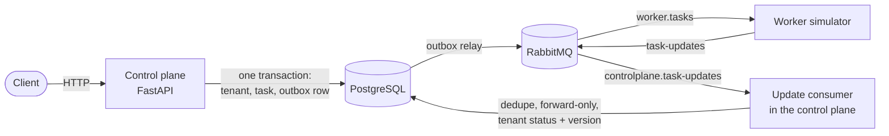
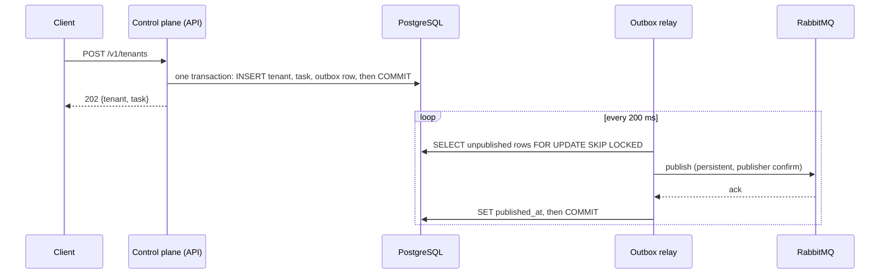

# Tenant Control Plane

[](https://github.com/aarushisinghalfde/tenant-control-plane/actions/workflows/check.yml)

An asynchronous tenant provisioning control plane. The HTTP API records tenants and their
tasks in PostgreSQL and publishes each task to RabbitMQ only after the write commits; a
separate worker simulator carries the task out and reports progress back over the broker;
the control plane applies that progress idempotently and in a forward-only way.



**Contents:** [Reviewer guide](#reviewer-guide) ·
[Design decisions and trade-offs](#design-decisions-and-trade-offs) · [API](#api) ·
[Messaging](#messaging) · [Worker simulator](#worker-simulator) · [Testing](#testing) ·
[Inspecting the system](#inspecting-the-system) · [Documentation](#documentation) ·
[Project layout](#project-layout) · [What I would do next](#what-i-would-do-next)

## Reviewer guide

About 15 minutes. You need **Git** and **Docker with Compose v2** (Docker Desktop on
Windows and macOS); everything else runs in containers. Commands work unchanged in bash
and PowerShell unless shown twice.

### 1. Boot and test

```bash
git clone https://github.com/aarushisinghalfde/tenant-control-plane.git
cd tenant-control-plane
docker compose up --build -d --wait                       # boot: PostgreSQL, RabbitMQ, API, worker
docker compose --profile tools run --rm --build check     # test: the full suite
```

The test command ends with `All checks passed.` after: format check, lint, strict types,
two security scans, ~200 unit and API contract tests, and 12 integration tests against
the running stack (about a minute). See [Testing](#testing) for what they cover.

| Open in a browser | What it is |
| --- | --- |
| <http://localhost:8000> | Interactive API docs (Swagger UI): make every call from the browser |
| <http://localhost:15672> | RabbitMQ dashboard, user `tenants`, password `tenants` (local-development only) |

### 2. Create a tenant and watch it go live (no manual steps)

In the API docs at <http://localhost:8000>:

1. **POST /v1/tenants** → **Try it out** → **Execute** (the example body is ready to send).
   Response `202`: the tenant is `provisioning` (version 1) with a `deploy` task `accepted`.
   Copy `tenant.id`.
2. **GET /v1/tenants/{tenant_id}** → **Try it out** → paste the id → **Execute**. Within a
   few seconds and a click or two it becomes `active` at version 2: the worker did the deploy.
3. **GET /v1/tenants/{tenant_id}/tasks**: its `deploy` task is now `done` (it went
   `accepted` → `in_progress` → `done`; the worker logs show each step).

Execute step 1 again unchanged: `409 tenant_already_exists`, as the slug is taken.

From a terminal instead (bash):

```bash
curl -s -X POST localhost:8000/v1/tenants -H 'Content-Type: application/json' \
  -d '{"slug": "acme-corp", "name": "Acme Corp"}'
curl -s localhost:8000/v1/tenants/<tenant-id>
```

PowerShell:

```powershell
$t = (Invoke-RestMethod -Method Post -Uri http://localhost:8000/v1/tenants `
  -ContentType 'application/json' -Body '{"slug":"acme-corp","name":"Acme Corp"}').tenant
Invoke-RestMethod http://localhost:8000/v1/tenants/$($t.id)
```

### 3. Watch the messages

In the RabbitMQ dashboard, **Queues and Streams**:

| Queue | What it holds |
| --- | --- |
| `worker.tasks` | Tasks published by the control plane, waiting for the worker |
| `controlplane.task-updates` | Progress updates published by the worker, waiting for the control plane |
| `controlplane.task-updates.dlq` | Poison updates the control plane rejected |

With everything running, both main queues drain within seconds; the **Overview** page
shows the message rates. `docker compose logs -f control-plane worker` shows each task the
worker takes and each update the control plane applies (`applied`, `duplicate`, `stale`).

### 4. Update and delete

1. **PATCH /v1/tenants/{tenant_id}** → paste the id → **Execute** (the example sends
   `"version": 2`, the version of a freshly active tenant). `202`: `updating`, version 3.
2. **Execute the same request again**: `409 tenant_version_conflict` ("version 2 is stale;
   current version is 3" or 4). Optimistic locking stops the lost update.
3. **GET** the tenant: back to `active`, version 4, new name.
4. **DELETE /v1/tenants/{tenant_id}**: `202`, `destroying`; **GET** shortly after:
   `destroyed`, version 6. `version` rose on every change, including the worker's.

### 5. Negative scenarios: restart the worker with other settings

| Scenario | bash | PowerShell |
| --- | --- | --- |
| Every task fails | `WORKER_FAIL_RATE=1 docker compose up -d worker` | `$env:WORKER_FAIL_RATE="1"; docker compose up -d worker; Remove-Item Env:WORKER_FAIL_RATE` |
| Duplicates and out-of-order updates | `docker compose stop worker` then `docker compose run --rm worker --duplicate-rate=1 --reorder` (runs in the foreground; Ctrl+C when done) | same |
| Back to normal | `docker compose up -d worker` | same |

Then create a tenant (step 2). With failures: the tenant ends `failed` and its task carries
the error; DELETE still works from `failed`. With duplicates and reordering: the logs show
`done: applied`, `done: duplicate`, `in_progress: stale`, and the tenant still ends
`active` at version 2. All flags: [Worker simulator](#worker-simulator).

### 6. Negative scenarios: publish to the broker directly

First stop the worker, so only your messages touch the task; then create a tenant
(step 2) and copy `task.id` from the response. It stays `provisioning`, as nobody works on it.

```bash
docker compose stop worker
# create a tenant now, then:
docker compose --profile tools run --rm publish duplicate <task-id>   # done, twice
docker compose --profile tools run --rm publish stale <task-id>       # done, then late in_progress
docker compose --profile tools run --rm publish poison                # not a task update at all
docker compose --profile tools run --rm publish unknown-task          # well formed, no such task
docker compose logs --tail 20 control-plane
docker compose start worker
```

Each run prints what it sent and what to expect. `duplicate` changes the tenant once;
`stale` leaves the task `done`; `poison` and `unknown-task` land in
`controlplane.task-updates.dlq` (watch its count in the dashboard) and the consumer keeps
going. When the worker starts again its own updates for that task are `stale`.

With the broker's own tooling instead: dashboard → **Exchanges** → `task-updates` →
**Publish message**, routing key `task.update.done`, payload:

```json
{"schema_version": 1, "message_id": "8d1c3f0e-0000-4000-8000-000000000001",
 "task_id": "<task-id>", "tenant_id": "<tenant-id>", "status": "done", "error": null,
 "occurred_at": "2026-11-13T10:00:00.000Z"}
```

Publish it twice: the second is a `duplicate`. Change `task_id` to any other UUID: dead-lettered.

### 7. Look inside

See [Inspecting the system](#inspecting-the-system) for log commands and SQL queries over
the outbox, the idempotency records and the task history.

### 8. Reset

```bash
docker compose down -v      # stop everything and delete all data
```

## Design decisions and trade-offs

| Decision | Why | Trade-off |
| --- | --- | --- |
| **Transactional outbox** for publishing | The task and its event commit in one transaction; a relay publishes committed rows. Nothing is published before commit or on rollback, and a crash between commit and publish cannot lose the event | Up to ~200 ms extra latency; delivery is at-least-once, so consumers must be idempotent |
| **At-least-once everywhere, idempotent consumer** | Exactly-once delivery does not exist. Each update's `message_id` is stored in `processed_messages` in the same transaction as its effect; ack only after commit | One extra table and insert per update; the table grows (cleanup is future work) |
| **Forward-only task status** (accepted 0, in_progress 1, done/failed 2) | Order tolerance without sequence numbers: a `done` before `in_progress` is kept and the late `in_progress` ignored; nothing moves a finished task | A worker cannot "undo" an outcome; a new task is needed instead |
| **Optimistic locking with `version` in the PATCH body, 409 on conflict** | One guarded `UPDATE ... WHERE status = ANY(...) AND version = $n`: of two concurrent PATCHes exactly one matches. Body field keeps the API simple for clients | Not the HTTP `If-Match` / 412 convention; documented instead |
| **Database constraints decide races** | `UNIQUE (slug)` settles concurrent creates; the guarded `UPDATE` settles PATCH/DELETE races; a partial unique index backstops "one open task per tenant" | Rules exist in both Python (for clear errors) and SQL (for correctness) |
| **Plain SQL with asyncpg, no ORM** | The concurrency guarantees live in exact statements, which stay visible and reviewable in one file | More hand-written mapping code |
| **RabbitMQ** | Task-queue semantics built in: durable quorum queues, publisher confirms, manual acks, dead-letter exchanges; runs locally | Not a replayable log like Kafka; SQS was ruled out as it does not run locally |
| **Worker update ids are `uuid5(task id, status)`** | A task redone after a worker crash sends the same ids, so repeats dedupe | Two different "done" reports for one task would share an id (cannot happen: a task has one outcome) |
| **Poison handling**: reject without requeue, retry transient errors with backoff, dead-letter after 5 deliveries | One bad message never blocks or kills the consumer | Dead-lettered messages need a person (no replay tool yet) |
| **Consumer and relay run inside the API process** | One deployable control plane, simple to run and reason about | They scale with the API; a separate deployment would be the next step under load |
| **400 `validation_failed`** instead of FastAPI's 422 | One error shape and status family for every bad input | Deviates from FastAPI's default; the OpenAPI document is adjusted to match |
| **Keyset pagination** on `(created_at, id)` | Stable pages while rows are inserted; uses an index | No "jump to page N" |
| **No authentication** | Not in the brief; kept out to stay focused | Must sit behind an authenticating gateway before real use |
| **Configuration from environment variables**; local-dev defaults committed in `compose.yaml` and `.env.example` | A cold clone boots with one command. The committed values are labelled local-only credentials for throwaway containers; `.env` is git-ignored | Real deployments must supply their own values (environment or a secrets manager) |

The step-by-step flow through the code, with class diagrams, is in
[docs/architecture.md](docs/architecture.md).

## API

| Method and path | Purpose | Success |
| --- | --- | --- |
| `POST /v1/tenants` | Create a tenant and its `deploy` task | `202` + `Location` |
| `GET /v1/tenants` | List; filter `?status=`; paginate `?limit=&cursor=` | `200` |
| `GET /v1/tenants/{id}` | Get one tenant | `200` |
| `PATCH /v1/tenants/{id}` | Partial update (`name`) with `version`; creates an `update` task | `202` |
| `DELETE /v1/tenants/{id}` | Start destroying; creates a `destroy` task | `202` |
| `GET /v1/tenants/{id}/tasks` | Tasks of one tenant | `200` |
| `GET /v1/tasks` | List; filter `?tenant_id=&type=&status=`; paginate | `200` |
| `GET /v1/tasks/{id}` | Get one task | `200` |

Every error has the same shape, so clients can branch on `code`. `details` appears only when
specific inputs are involved, and is always a list of `{field, message}`:

```json
{
  "error": {
    "code": "tenant_version_conflict",
    "message": "version 2 is stale; current version is 3",
    "details": [{"field": "version", "message": "must equal current version 3"}]
  }
}
```

Empty results are not errors: a list with no matches returns `200` with
`{"items": [], "next_cursor": null}`, and `next_cursor` is `null` on the last page. A single
resource that does not exist returns `404`.

| Code | HTTP status | When |
| --- | --- | --- |
| `validation_failed` | 400 | Malformed body, query or id; unknown field; invalid cursor |
| `tenant_not_found` | 404 | No tenant with that id |
| `task_not_found` | 404 | No task with that id |
| `tenant_already_exists` | 409 | Slug taken, including by a destroyed tenant |
| `tenant_update_not_allowed` | 409 | PATCH outside `active`; DELETE outside `active` / `failed` |
| `tenant_version_conflict` | 409 | `version` in the PATCH body is not the current version |
| `not_found` / `method_not_allowed` | 404 / 405 | Unknown route or wrong HTTP method |
| `internal_error` | 500 | Anything unexpected (details are logged, never returned) |

## Messaging

Tasks leave the control plane through a **transactional outbox**. A request never talks
to the broker: it writes the tenant, the task and an `outbox` row in one transaction.
A background relay inside the control plane then publishes committed rows and marks
them, so an event goes out only after its write is durable, never on rollback, and is
not lost if the process dies between commit and publish.



- **At-least-once.** If the relay dies after the broker confirms but before it marks the
  row, the event is sent again. The AMQP `message_id` is the task id, so consumers can
  drop duplicates.
- **Retries.** A failed publish increments the row's `attempts`, stops the batch (events
  keep their order) and retries with exponential backoff and jitter, capped at 30 s.
- **Replicas.** `SKIP LOCKED` lets several relays share the outbox without waiting on or
  double-publishing each other's rows.

| Exchange (type) | Routing key | Queue | Direction |
| --- | --- | --- | --- |
| `tasks` (topic) | `task.<type>` | `worker.tasks` | control plane -> worker |
| `task-updates` (topic) | `task.update.<status>` | `controlplane.task-updates` | worker -> control plane |
| `task-updates.dlx` (fanout) | any | `controlplane.task-updates.dlq` | rejected (poison) updates |

Updates flow back through the **update consumer** inside the control plane. Each one is
applied in a single transaction that also records its `message_id` in
`processed_messages`, and the message is acknowledged only after that commit:

- **Idempotent.** A `message_id` already recorded is a duplicate: acknowledged, nothing changes.
- **Order-tolerant.** Tasks only move forward (`accepted` -> `in_progress` -> `done`/`failed`).
  A late `in_progress` after `done`, or anything for a finished task, is acknowledged and ignored.
- **Tenant follows the outcome.** `done` or `failed` moves the tenant (for example
  `provisioning` -> `active`) and bumps its `version`.
- **Poison messages** (invalid JSON or schema, unknown task, wrong tenant) are rejected into
  `controlplane.task-updates.dlq` and the consumer carries on.
- **Temporary failures** (database down) are retried with backoff; after 5 deliveries the
  message is dead-lettered instead of blocking the queue.

All queues are durable quorum queues and all messages are persistent. `/readyz` reports
ready only while both the database and the broker connection are up.

## Worker simulator

A separate process (`worker/`, compose service `worker`) that plays the provisioning
side; with it running, a new tenant walks `provisioning` -> `active` on its own. For each task on `worker.tasks` it waits, publishes `in_progress`, waits, publishes
`done` or `failed` to the `task-updates` exchange, and only then acknowledges the task.

Each update carries its own idempotency key and names the task and tenant it is about:

```json
{
  "schema_version": 1,
  "message_id": "6f1c1c1e-9a43-5b0e-8e4a-0d9f3c2b7a11",
  "task_id": "12abc171-5933-4777-bb38-00ddb65b5ec1",
  "tenant_id": "13adfc44-c323-4124-a4cf-b9ba3a68c3a9",
  "status": "failed",
  "error": "simulated provisioning failure",
  "occurred_at": "2026-11-13T10:00:01.456Z"
}
```

`message_id` is derived from the task id and the status (UUIDv5), so if the worker dies
half-way and the broker redelivers the task, the repeated updates carry the same ids and
the control plane recognises them as duplicates.

| Flag | Environment variable | Default | Effect |
| --- | --- | --- | --- |
| `--fail-rate` | `WORKER_FAIL_RATE` | `0` | Chance (0-1) that a task ends `failed` |
| `--min-delay-ms` / `--max-delay-ms` | `WORKER_MIN_DELAY_MS` / `WORKER_MAX_DELAY_MS` | `500` / `2000` | Random wait before each update |
| `--duplicate-rate` | `WORKER_DUPLICATE_RATE` | `0` | Chance (0-1) that each update is sent twice, byte for byte |
| `--reorder` | `WORKER_REORDER` | `false` | Send the outcome first, then a stale `in_progress` |
| `--seed` | `WORKER_SEED` | random | Fix the random choices for a repeatable run |
| `--concurrency` | `WORKER_CONCURRENCY` | `4` | Tasks handled at once |

A flag wins over its variable. Change the scenario by restarting the worker:

```bash
# bash (macOS, Linux)
WORKER_FAIL_RATE=1 docker compose up -d worker            # every task fails
docker compose stop worker                                # or: one-off run with flags
docker compose run --rm worker --duplicate-rate=1 --reorder
docker compose up -d worker                               # back to defaults
```

```powershell
# PowerShell (Windows)
$env:WORKER_FAIL_RATE = "1"; docker compose up -d worker; Remove-Item Env:WORKER_FAIL_RATE
docker compose stop worker
docker compose run --rm worker --duplicate-rate=1 --reorder
docker compose up -d worker
```

`docker compose logs -f worker` shows each task and every update it sends.

## Testing

```bash
docker compose up --build -d --wait                     # boot
docker compose --profile tools run --rm --build check   # the full suite
```

`check` runs, in order, and stops at the first failure: format check, lint, strict type
check, a code security scan (bandit), a dependency vulnerability scan (pip-audit), the
unit and API contract tests, and the integration tests. With `--build` it also rebuilds
the application image and recreates the control plane and worker if the code changed, so
the integration tests always run against the current code; it starts the stack if it is
not running.

| Suite | Runs against | Covers |
| --- | --- | --- |
| `tests/unit` | Pure Python, fakes | Every tenant and task state transition, worker settings and simulation plan, outbox relay and consumer decisions (ack, retry, dead-letter), message formats, the publish script's scenarios, timestamps, cursors |
| `tests/api` | The HTTP app with faked services | Status codes, the error body and every error code, validation, OpenAPI document |
| `tests/integration` | The real stack: API, PostgreSQL, RabbitMQ, worker | Full lifecycle with no manual step; failed deploy then destroy; destroyed slugs stay taken; 20 parallel creates with one slug, 50 parallel PATCHes with one version and 10 parallel DELETEs each have exactly one winner and leave nothing behind; one published event per task; rejected writes publish nothing; duplicate updates change state once; a late `in_progress` never regresses `done`; poison messages go to the dead-letter queue while the consumer keeps going |

The integration tests publish hand-made updates straight to RabbitMQ where they need exact
control over order and duplication, so they do not depend on the worker's random timing.
Run outside the compose network (plain `pytest`), they are skipped with a message saying how
to run them.

GitHub Actions runs the same two commands, boot then `check`, on every push
([.github/workflows/check.yml](.github/workflows/check.yml)); the badge at the top shows
the latest result.

Two behaviours are shown by manual runs rather than automated tests, because they need the
broker or the control plane stopped mid-test: a write while RabbitMQ is down is published once
it returns ([evidence](docs/evidence/outbox-broker-outage.md)), and data survives restarts
(the same tenants persist across every rebuild in the [evidence pages](docs/evidence/README.md)).

## Inspecting the system

```bash
docker compose ps                                      # what is running and healthy
docker compose logs -f control-plane worker            # API requests, relay, consumer, worker
curl -s localhost:8000/readyz                          # {"status":"ready","database":true,"broker":true}
```

Health-probe requests (`/healthz`, `/readyz`, polled by Docker every few seconds) are
left out of the access log so the useful lines stay readable.

SQL, through `docker compose exec postgres psql -U tenants -d tenants -c "<query>"`:

| Question | Query |
| --- | --- |
| Latest tenants | `SELECT slug, status, version, updated_at FROM tenants ORDER BY created_at DESC LIMIT 10;` |
| Events waiting or published | `SELECT routing_key, attempts, published_at FROM outbox ORDER BY id DESC LIMIT 10;` |
| Updates applied per task | `SELECT task_id, count(*) FROM processed_messages GROUP BY task_id ORDER BY count(*) DESC LIMIT 10;` |
| A tenant's task history | `SELECT type, status, error, created_at FROM tasks WHERE tenant_id = '<tenant-id>' ORDER BY created_at;` |

The RabbitMQ dashboard's **Queues** page can also show any message without consuming it:
open a queue → **Get messages** with "Nack message requeue true".

## Documentation

| Document | Contents |
| --- | --- |
| [docs/architecture.md](docs/architecture.md) | Layers and class diagram, startup sequence, step-by-step lifecycle of a request through the outbox, the worker and the consumer |
| [docs/evidence/](docs/evidence/README.md) | Manual runs against the real stack, with commands, output and screenshots |
| [requests.http](requests.http) | Click-through API tour for the VS Code REST Client extension, carrying ids and versions between requests |
| <http://localhost:8000> | Interactive API reference (after boot), generated from the code |

## Tech stack

| Concern | Choice |
| --- | --- |
| Language | Python 3.12 |
| HTTP API | FastAPI + uvicorn |
| Validation | Pydantic v2 |
| Database | PostgreSQL 16 (asyncpg, plain SQL) |
| Broker | RabbitMQ 3.13 (aio-pika) |
| Tests | pytest + pytest-asyncio + httpx |
| Quality gate | ruff (format + lint), mypy (strict), bandit, pip-audit |

## Project layout

The code is layered: each layer only depends on the ones below it, and the domain
depends on nothing.

```text
app/
  main.py                 app factory: wires layers together, startup and shutdown
  api/                    HTTP layer
    routes/                 one router per resource: tenants, tasks, health
    schemas.py              request/response bodies and the error body
    dependencies.py         service lookup, page size, cursor parsing
    error_handlers.py       exceptions -> structured JSON errors, status mapping
    openapi.py              keeps the Swagger docs in line with the real error shape
  services/               use cases, one transaction per state change
    tenant_service.py
    task_service.py
    task_update_service.py  one worker update -> task and tenant, in one transaction
  domain/                 business rules, pure logic with no I/O
    models.py               entities and statuses
    rules.py                tenant and task state machines
    errors.py               domain errors and their API codes
  db/                     persistence
    database.py             pool, migrations, transactions
    repository.py           all SQL
  messaging/              broker integration
    events.py               message formats: TaskEvent (out), TaskUpdate (in)
    broker.py               RabbitMQ connection, topology, publishing, consuming
    outbox_relay.py         background loop: outbox rows -> broker
    consumer.py             applies worker updates; dedupe, retry, dead-letter
  core/                   shared helpers with no business knowledge
    config.py               settings from environment variables
    clock.py                UTC millisecond timestamps
    backoff.py              exponential backoff with jitter
    logs.py                 keeps health-probe requests out of the access log
    pagination.py           keyset cursors
migrations/               SQL schema, applied at startup
worker/                   worker simulator (separate process)
  main.py                   consumes worker.tasks, publishes updates, acks last
  simulation.py             decides outcome, order, duplicates and delays (pure)
  config.py                 flags and their environment-variable twins
tests/
  unit/                   rules, helpers, schemas, events, relay, consumer, worker
  api/                    HTTP contract with faked services
  integration/            end to end against the running stack
requests.http             click-through API tour (VS Code REST Client)
scripts/                  check.sh (quality gate), publish_update.py (hand-made broker messages)
.github/workflows/        CI: the same boot and check commands on every push
```

## What I would do next

- **Cleanup jobs** for published outbox rows and old `processed_messages`.
- **Dead-letter replay**: a command to inspect and re-publish messages from the DLQ.
- **Metrics and tracing**: outbox lag, consumer throughput and failures, a trace id carried
  from the request through the task to the worker's updates.
- **Authentication and per-tenant authorization** in front of the API.
- **Retry delay queues** instead of in-process backoff, so a slow retry does not hold a consumer slot.
- **A broker-outage test** in CI (stop RabbitMQ mid-test), today shown by a manual run.
