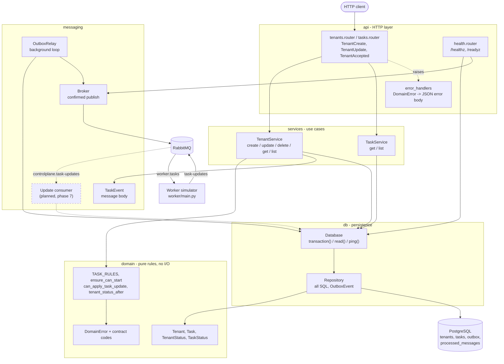
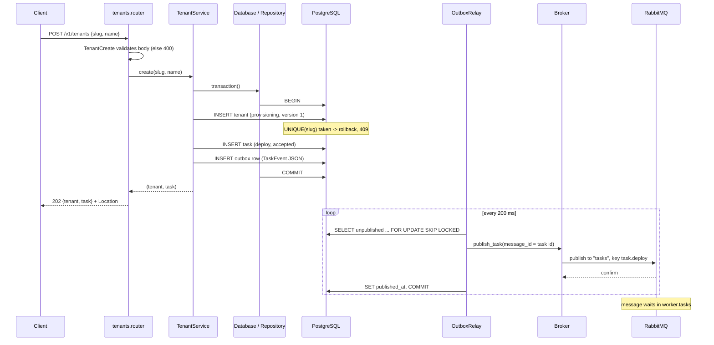

# Architecture

How the code is organised, how the classes connect, and what happens step by step
when a tenant is created. Covers what is built so far (API, database, outbox relay,
RabbitMQ, worker simulator); the update consumer, arriving in phase 7, is marked *planned*.

## Layers

Each layer only calls the layers below it; `domain` depends on nothing.

`app/main.py` wires it all together at startup (the `lifespan` function); `app/core`
holds small shared helpers (settings, clock, pagination cursors, backoff) used by
several layers.

| Layer | Classes and functions | Responsibility |
| --- | --- | --- |
| `api` | `tenants.router`, `tasks.router`, `health.router`, request/response schemas, `error_handlers` | HTTP only: validate input, call a service, shape the response, map errors to status codes |
| `services` | `TenantService`, `TaskService` | One use case per method; every state change is one database transaction |
| `domain` | `Tenant`, `Task`, statuses, `TASK_RULES`, rule functions, `DomainError` subclasses | The state machines and error codes; pure Python, unit-tested in isolation |
| `db` | `Database`, `Repository`, `OutboxEvent` | Connection pool, migrations, transactions; every SQL statement |
| `messaging` | `TaskEvent`, `Broker`, `declare_topology`, `OutboxRelay` | Message formats, RabbitMQ topology and publishing |
| `core` | `Settings`, `utc_now`, `Cursor`, `backoff_delay` | Shared helpers with no business knowledge |

## Startup

`lifespan()` in `app/main.py`, in order:

1. `load_settings()` reads `DATABASE_URL`, `RABBITMQ_URL` and `LOG_LEVEL`, and fails fast if one is missing.
2. `create_pool()` opens the PostgreSQL connection pool.
3. `run_migrations()` applies any new `migrations/*.sql`, holding an advisory lock so two replicas cannot migrate at once.
4. `Broker.connect()` opens a self-healing RabbitMQ connection and runs `declare_topology()`: exchanges, quorum queues, bindings and the dead-letter queue.
5. `OutboxRelay(db, broker).run()` starts as a background task.
6. `TenantService` and `TaskService` are created and stored on `app.state`, where the routes find them.

Shutdown runs in reverse: cancel the relay, close the broker connection, close the pool.

## Lifecycle of `POST /v1/tenants`

Step by step:

1. **Validate.** FastAPI parses the body into `TenantCreate`: unknown fields, a blank name or a slug that breaks `^[a-z][-a-z0-9]{1,26}[a-z0-9]$` give `400 validation_failed` before any code of ours runs.
2. **Call the service.** The route calls `TenantService.create()`, which builds a `Tenant` in status `TASK_RULES[deploy].in_flight` (`provisioning`) at version 1.
3. **Open one transaction.** `Database.transaction()` yields a `Repository` bound to one connection; everything below commits together or not at all.
4. **Insert the tenant.** `Repository.insert_tenant()`. If the slug is taken, the `UNIQUE (slug)` constraint raises, the repository turns it into `TenantAlreadyExistsError`, the transaction rolls back, and `error_handlers` returns `409 tenant_already_exists`. This also decides races: of two concurrent creates, the database lets exactly one insert win.
5. **Insert the task.** `_start_task()` inserts a `deploy` task in status `accepted`.
6. **Insert the outbox row.** In the same transaction it builds `TaskEvent.for_task()` and writes it to `outbox` with routing key `task.deploy`. The broker is not touched.
7. **Commit and respond.** The transaction commits; the route returns `202 Accepted` with the tenant, the task and a `Location` header.
8. **Relay picks it up.** Within about 200 ms, `OutboxRelay.publish_batch()` locks unpublished rows (`FOR UPDATE SKIP LOCKED`). Only committed rows are visible, so nothing is published early, and a rolled-back write never has a row.
9. **Publish with confirmation.** `Broker.publish_task()` sends the JSON to the `tasks` exchange as a persistent message whose `message_id` is the task id, and waits for RabbitMQ's confirm.
10. **Mark it published.** The relay sets `published_at` and commits. If publishing fails, it increments `attempts`, stops the batch (keeping order) and retries after `backoff_delay()`.
11. **Queued for a worker.** The `task.*` binding routes the message into the `worker.tasks` queue, where it waits for the worker.

`PATCH` and `DELETE` follow the same shape, except that step 4 is one guarded statement:
`UPDATE tenants ... WHERE id = $1 AND status = ANY(allowed) AND version = $expected`.
If it matches no row, `_explain_rejection()` reads the tenant to raise the right error
(`tenant_not_found`, `tenant_version_conflict` or `tenant_update_not_allowed`) and the
transaction rolls back, so no task or outbox row is written.

## The worker simulator (phase 6)

12. The **worker** (`worker/main.py`, class `Worker`) consumes `worker.tasks`, at most `--concurrency` tasks at a time. For each it asks `plan_steps()` (`worker/simulation.py`) what to send: `in_progress` then `done`, or `failed` with probability `--fail-rate`, optionally reordered or duplicated. It publishes each `TaskUpdate` to the `task-updates` exchange with publisher confirms, and acknowledges the task only after the last update is confirmed. A malformed task is rejected without requeue; if the broker fails mid-task, the task is requeued and redone, and because each `message_id` is `uuid5(task id, status)`, the repeats look like duplicates to the consumer. Until phase 7 the updates wait in `controlplane.task-updates`.

## Planned: applying updates (phase 7)

13. The **update consumer** in the control plane reads `controlplane.task-updates`. In one transaction it records the `message_id` in `processed_messages` (a duplicate is skipped), checks `can_apply_task_update()` so a stale update cannot move the task backwards, updates the task, and on a terminal outcome moves the tenant (`tenant_status_after()`) and bumps its version. It acknowledges the message only after commit; a malformed message is rejected into the dead-letter queue.

## Related documents

- [README](../README.md): setup, API reference, design decisions
- [Evidence](evidence/README.md): manual runs against the real stack, with output and screenshots
