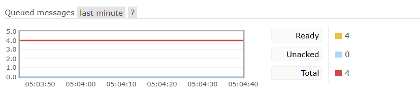

# Evidence: the outbox survives a broker outage

**Claim.** A tenant write succeeds while RabbitMQ is down; its event is published
automatically once the broker returns; nothing is lost or published early.

**Setup.** Stack booted with `docker compose up --build -d --wait`. No worker running
yet, so published tasks stay queued in `worker.tasks` where they can be counted.
Commands are PowerShell (Windows). Timestamps are UTC.

## 1. Normal path

```powershell
Invoke-RestMethod -Method Post -Uri http://localhost:8000/v1/tenants `
  -ContentType 'application/json' `
  -Body '{"slug":"acme-corp","name":"Acme Corp"}' | ConvertTo-Json -Depth 5
```

`202 Accepted`: tenant `provisioning`, task `deploy` / `accepted`, both stamped
`2026-11-12T23:21:12.219Z`. The outbox row was published about 0.3 s later
(`published_at 23:21:12.516`, table in step 4).

## 2. Stop the broker, keep writing

```powershell
docker compose stop rabbitmq

Invoke-RestMethod -Method Post -Uri http://localhost:8000/v1/tenants `
  -ContentType 'application/json' `
  -Body '{"slug":"beta-corp","name":"Beta Corp"}' | ConvertTo-Json -Depth 5
```

Still `202 Accepted` (`created_at 2026-11-12T23:28:28.777Z`): the request writes only to
PostgreSQL and never touches the broker.

```powershell
curl.exe -s localhost:8000/readyz
```

```json
{"status":"unavailable","database":true,"broker":false}
```

Readiness reports the outage (HTTP 503) instead of claiming to be healthy.

## 3. The event waits in the outbox and is retried

```powershell
docker compose exec postgres psql -U tenants -d tenants `
  -c "SELECT routing_key, attempts, published_at FROM outbox ORDER BY id;"
```

```text
 routing_key | attempts |        published_at
-------------+----------+----------------------------
 task.deploy |        0 | 2026-11-12 23:21:12.516+00
 task.deploy |        0 | 2026-11-12 23:27:56.861+00
 task.deploy |       11 |
```

`beta-corp`'s event is unpublished, and `attempts` keeps rising: the relay retries
with exponential backoff and jitter, capped at 30 s, instead of crashing or giving up.

## 4. Start the broker: the event goes out by itself

```powershell
docker compose start rabbitmq
# wait about 30-40 s, then rerun the query from step 3
```

```text
 routing_key | attempts |        published_at
-------------+----------+----------------------------
 task.deploy |        0 | 2026-11-12 23:21:12.516+00
 task.deploy |        0 | 2026-11-12 23:27:56.861+00
 task.deploy |       15 | 2026-11-12 23:30:41.752+00
 task.deploy |        0 | 2026-11-12 23:31:03.868+00
```

- `beta-corp` was published at 23:30:41, about 2 min 13 s after its write, after 15
  failed attempts. Nobody restarted the control plane: the broker connection
  reconnected by itself.
- The fourth row (a tenant created after recovery) went out within milliseconds, so
  the relay is back to normal speed.

## 5. Nothing lost, including across the broker restart

RabbitMQ management UI (<http://localhost:15672>) → Queues → `worker.tasks`:



Ready = 4: one message per outbox row. The first two were already queued when the
broker was stopped and are still there after it restarted, because they are
persistent messages on a durable quorum queue, and the compose file pins the broker's
host name so it reopens the same data directory.

## What this shows

| Requirement (brief) | Shown by |
| --- | --- |
| Publish only after the write is durably committed | Requests write the outbox row; only the relay publishes |
| Never lose an event | `beta-corp` was published after the outage |
| Transient broker failures retried with backoff | `attempts` 0 → 11 → 15, then success |
| Self-healing | No restart of the control plane |
| Persistence | Queued messages survived the broker restart |

Automated versions of these checks are planned for `tests/integration/` (phase 8).
