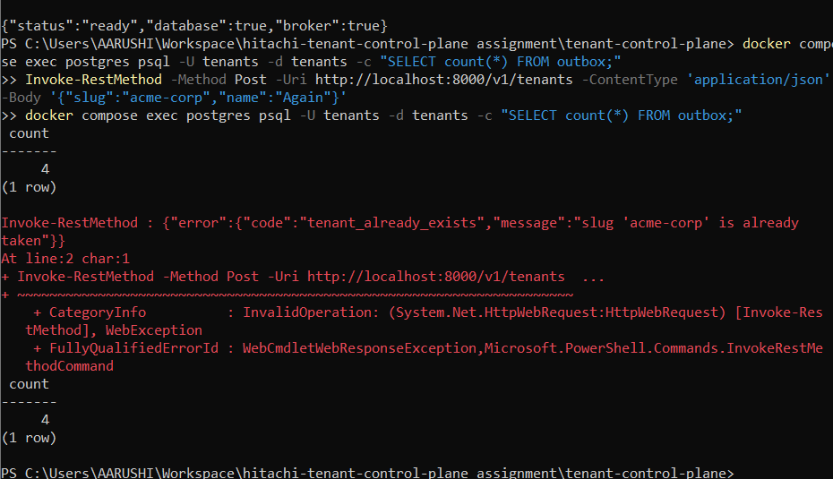
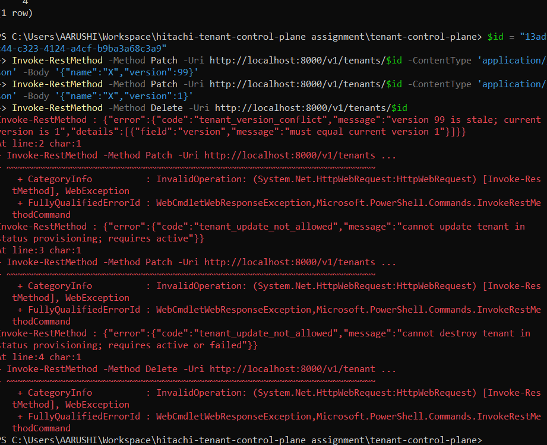

# Evidence: rejected writes change nothing and publish nothing

**Claim.** When the API refuses a write (taken slug, stale version, wrong tenant
status), the transaction rolls back: no tenant change, no task, no outbox row, so no
event is ever published for it. The client gets a structured, machine-readable error.

**Setup.** Same stack as in [outbox-broker-outage.md](outbox-broker-outage.md): four
tenants exist, all still `provisioning` because no worker is running yet. Commands are
PowerShell (Windows); `Invoke-RestMethod` prints error responses in red, with the JSON
body as the message.

## 1. Duplicate slug: 409, and the outbox count does not move

```powershell
docker compose exec postgres psql -U tenants -d tenants -c "SELECT count(*) FROM outbox;"
Invoke-RestMethod -Method Post -Uri http://localhost:8000/v1/tenants `
  -ContentType 'application/json' -Body '{"slug":"acme-corp","name":"Again"}'
docker compose exec postgres psql -U tenants -d tenants -c "SELECT count(*) FROM outbox;"
```

| Step | Result |
| --- | --- |
| Outbox rows before | 4 |
| Create with taken slug | `409` `{"error":{"code":"tenant_already_exists","message":"slug 'acme-corp' is already taken"}}` |
| Outbox rows after | 4 |



The `UNIQUE (slug)` constraint rejected the insert, and the whole transaction (tenant,
task and outbox row) rolled back together. That is the "never on rollback" half of
publish-after-commit.

## 2. State-machine and optimistic-lock guards

Tenant `acme-corp` (`13adfc44-c323-4124-a4cf-b9ba3a68c3a9`) is `provisioning`, version 1.

```powershell
$id = "13adfc44-c323-4124-a4cf-b9ba3a68c3a9"
Invoke-RestMethod -Method Patch -Uri http://localhost:8000/v1/tenants/$id `
  -ContentType 'application/json' -Body '{"name":"X","version":99}'
Invoke-RestMethod -Method Patch -Uri http://localhost:8000/v1/tenants/$id `
  -ContentType 'application/json' -Body '{"name":"X","version":1}'
Invoke-RestMethod -Method Delete -Uri http://localhost:8000/v1/tenants/$id
```

| Call | Status | Body |
| --- | --- | --- |
| PATCH, stale version 99 | 409 | `tenant_version_conflict`: "version 99 is stale; current version is 1", details `[{"field":"version","message":"must equal current version 1"}]` |
| PATCH, correct version, wrong status | 409 | `tenant_update_not_allowed`: "cannot update tenant in status provisioning; requires active" |
| DELETE while provisioning | 409 | `tenant_update_not_allowed`: "cannot destroy tenant in status provisioning; requires active or failed" |



All three go through one guarded `UPDATE ... WHERE status = ANY(...) AND version = ...`.
It matched no row, so nothing changed; the service then reads the row only to say *why*
(stale version first, then wrong status).

## What this shows

| Requirement (brief) | Shown by |
| --- | --- |
| Unique slug; the loser gets `tenant_already_exists` | Step 1 |
| Never publish on rollback | Outbox count 4 → 4 |
| Update only from `active`, delete only from `active` / `failed` | Step 2, rows 2-3 |
| `version`-based optimistic locking | Step 2, row 1 |
| Structured, machine-readable errors with contract codes | Every response above |

Concurrent versions of these checks (20 parallel same-slug creates, 50 parallel PATCHes
with the same version) are planned for `tests/integration/` (phase 8).
