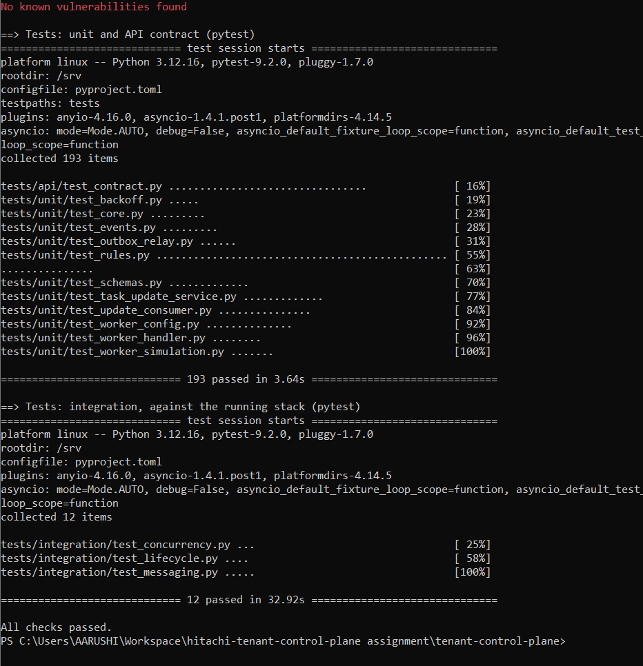
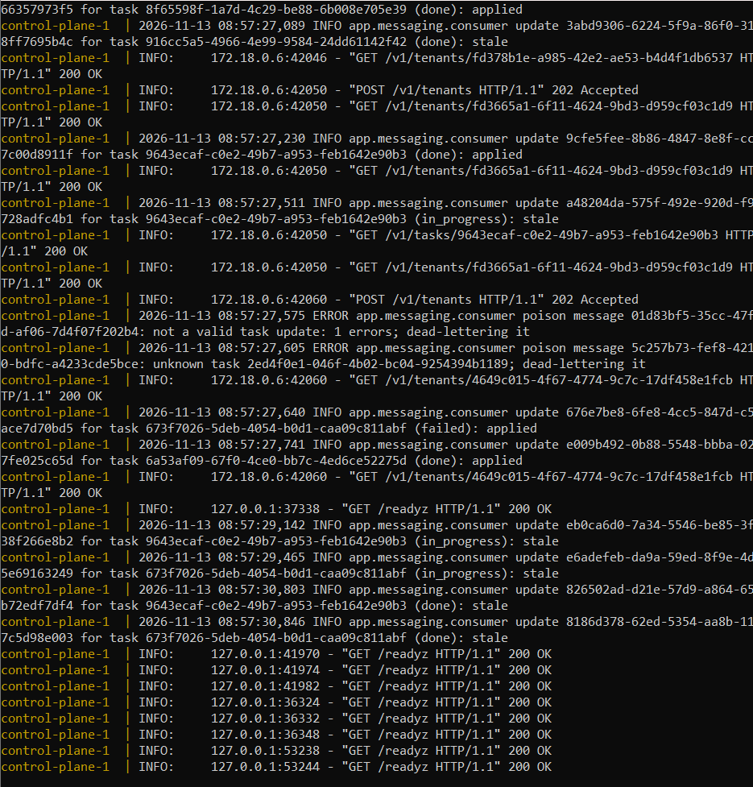

# Evidence: one command runs the whole suite

**Claim.** `docker compose --profile tools run --rm --build check` is the single test
command. It runs every quality gate and then, against the real stack, the end-to-end
tests for the lifecycle, the concurrency races and the messaging guarantees.

## Result

```powershell
docker compose --profile tools run --rm --build check
```

```text
==> Format (ruff format --check)          ok
==> Lint (ruff check)                     All checks passed!
==> Types (mypy --strict)                 Success: no issues found in 57 source files
==> Security: code (bandit)               ok
==> Security: dependencies (pip-audit)    No known vulnerabilities found
==> Tests: unit and API contract          193 passed in 3.64s
==> Tests: integration                    12 passed in 32.92s
All checks passed.
```



With `--build`, the command rebuilt the application image and recreated the control plane
and worker before testing, so the integration tests ran against the current code.

## What the integration tests did, seen from the control plane

While the suite ran, `docker compose logs -f control-plane` showed the tests driving the
real consumer:



- **Late `in_progress` (task `9643ecaf`):** the test's `done` is `applied`, its later
  `in_progress` is `stale`, the test reads the task back (`GET /v1/tasks/...`), and the
  worker's own updates for that task arrive afterwards as `stale` too.
- **Poison messages:** `poison message ...: not a valid task update; dead-lettering it` and
  `poison message ...: unknown task ...; dead-lettering it`, then the valid `failed` update
  sent right after them is `applied` (task `673f7026`): the consumer kept going.
- The two `ERROR` lines are expected: the test sends bad messages on purpose.

## What the 12 integration tests cover

| File | Tests |
| --- | --- |
| `test_lifecycle.py` | New tenant reaches `active` with no manual step; update then delete walks v1 -> v6 with three `done` tasks; a destroyed tenant's slug stays taken; a failed deploy fails the tenant, which can still be destroyed |
| `test_concurrency.py` | 20 parallel same-slug creates, 50 parallel same-version PATCHes and 10 parallel DELETEs each have exactly one winner, and the losers leave no tenant, task or event |
| `test_messaging.py` | Every task is published exactly once with its fields; a rejected write leaves no task and no event; the same update twice changes the tenant once; a late `in_progress` never regresses `done`; poison messages are dead-lettered while the next valid update is applied |
