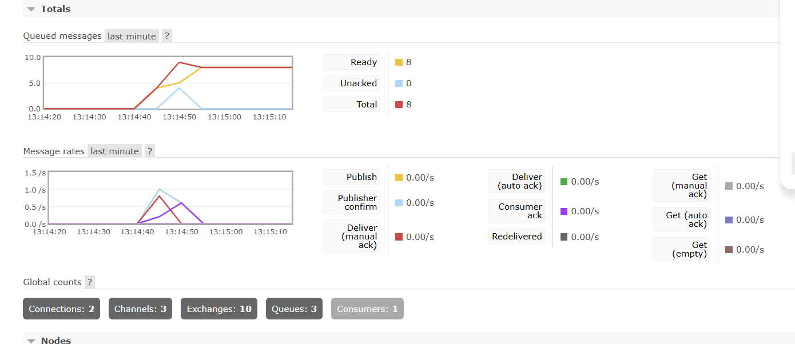
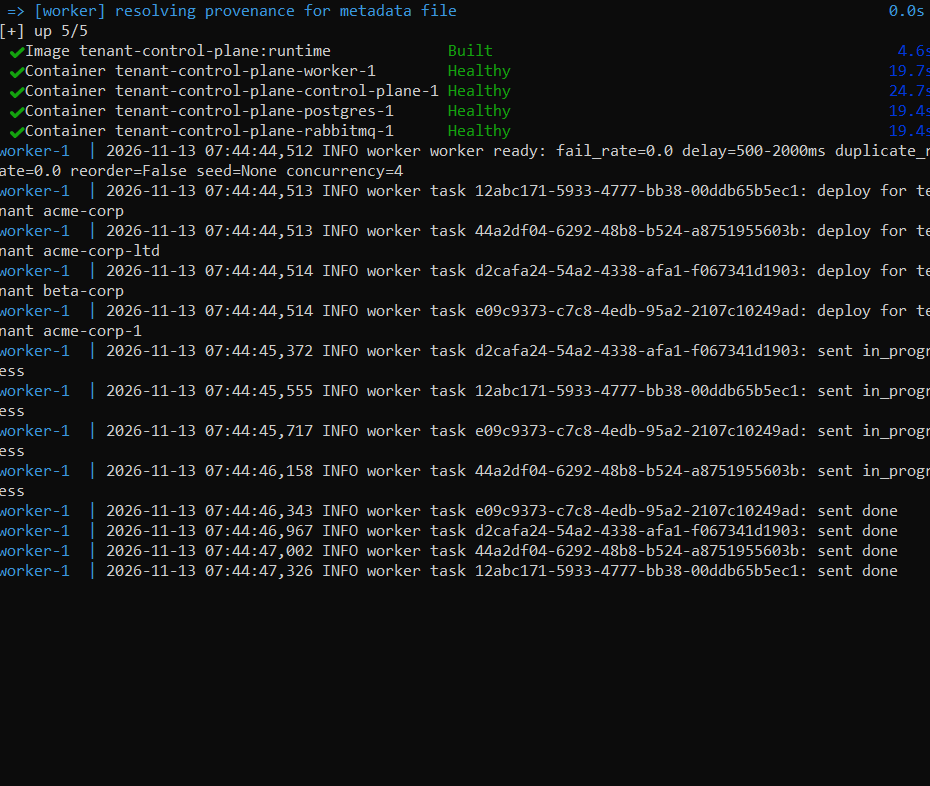
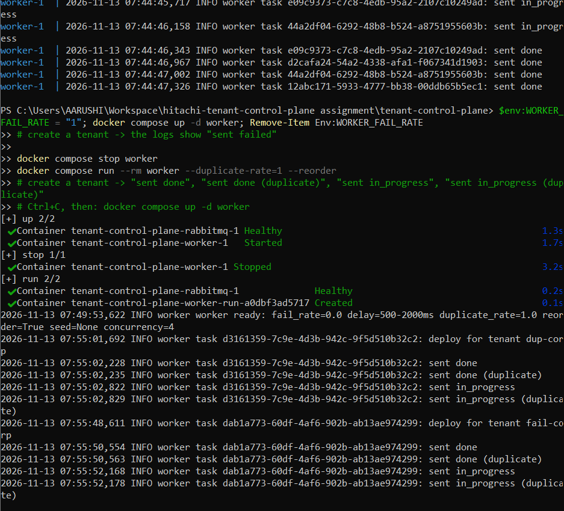

# Evidence: the worker simulator drains tasks and reports progress

**Claim.** The worker consumes every queued task, publishes `in_progress` and then an
outcome for each, and acknowledges a task only after its updates are confirmed.

**Setup.** Four deploy tasks were waiting in `worker.tasks` from the earlier runs (see
[outbox-broker-outage.md](outbox-broker-outage.md)). The stack was rebuilt with the worker
(`docker compose up --build -d --wait`), using the default settings: no failures,
duplicates or reordering, 500-2000 ms per step, concurrency 4. The update consumer
(phase 7) did not exist yet, so updates stayed queued where they could be counted.

## RabbitMQ overview while the worker started



| Reading | Meaning |
| --- | --- |
| Unacked rises to 4, then 0 | The worker took all 4 tasks at once (concurrency 4) and acknowledged each only after both of its updates were confirmed |
| Total queued goes from 4 to 8 | The 4 tasks left `worker.tasks`; 8 updates (`in_progress` + `done` per task) arrived in `controlplane.task-updates` |
| Deliver (manual ack), then Consumer ack | Tasks handed out with manual acknowledgement, then acknowledged |
| Connections 2, Consumers 1 | The control plane and the worker are connected; the worker consumes `worker.tasks` |
| Exchanges 10 | `tasks`, `task-updates`, `task-updates.dlx` plus RabbitMQ's 7 built-in `amq.*` exchanges |

## Worker logs

```powershell
docker compose up --build -d --wait
docker compose logs -f worker
```

```text
07:44:44,512 INFO worker worker ready: fail_rate=0.0 delay=500-2000ms duplicate_rate=0.0 reorder=False seed=None concurrency=4
07:44:44,513 INFO worker task 12abc171-...: deploy for tenant acme-corp
07:44:44,513 INFO worker task 44a2df04-...: deploy for tenant acme-corp-ltd
07:44:44,514 INFO worker task d2cafa24-...: deploy for tenant beta-corp
07:44:44,514 INFO worker task e09c9373-...: deploy for tenant acme-corp-1
07:44:45,372 INFO worker task d2cafa24-...: sent in_progress
07:44:45,555 INFO worker task 12abc171-...: sent in_progress
07:44:45,717 INFO worker task e09c9373-...: sent in_progress
07:44:46,158 INFO worker task 44a2df04-...: sent in_progress
07:44:46,343 INFO worker task e09c9373-...: sent done
07:44:46,967 INFO worker task d2cafa24-...: sent done
07:44:47,002 INFO worker task 44a2df04-...: sent done
07:44:47,326 INFO worker task 12abc171-...: sent done
```



- All four tasks start within the same millisecond: the worker processes up to
  `--concurrency` tasks at once.
- Every task reports `in_progress` and then `done`; each step waits inside the
  500-2000 ms window.
- They finish in a different order than they started, which is why the control
  plane's consumer must not depend on message order.

## Scenario: duplicates and out-of-order updates

```powershell
docker compose stop worker
docker compose run --rm worker --duplicate-rate=1 --reorder
# in a second window:
Invoke-RestMethod -Method Post -Uri http://localhost:8000/v1/tenants `
  -ContentType 'application/json' -Body '{"slug":"dup-corp","name":"Dup Corp"}'
```

```text
07:49:53,622 INFO worker worker ready: fail_rate=0.0 delay=500-2000ms duplicate_rate=1.0 reorder=True seed=None concurrency=4
07:55:01,692 INFO worker task d3161359-...: deploy for tenant dup-corp
07:55:02,228 INFO worker task d3161359-...: sent done
07:55:02,235 INFO worker task d3161359-...: sent done (duplicate)
07:55:02,822 INFO worker task d3161359-...: sent in_progress
07:55:02,829 INFO worker task d3161359-...: sent in_progress (duplicate)
```



The outcome arrives first, every update is sent twice with the same `message_id`, and a
stale `in_progress` follows the terminal `done`. This is the input the control plane's
consumer must absorb: the tenant must still end `active`, and neither the duplicates nor
the late `in_progress` may change anything.

## What this shows

| Requirement (brief) | Shown by |
| --- | --- |
| Worker is a separate process that consumes the published tasks | Consumers 1, `worker.tasks` emptied |
| Progress goes back over the broker: `in_progress`, then `done` / `failed` | 2 updates per task in `controlplane.task-updates` |
| At-least-once handling | A task is acknowledged only after its updates are confirmed |
| Duplicates and reordering on demand | `--duplicate-rate=1 --reorder` run |
| Configurable timing | Each step waited between 0.63 and 1.77 s, inside the 500-2000 ms window |

Failure, duplicate and reorder scenarios are triggered by restarting the worker with
flags or `WORKER_*` variables; see the README's "Worker simulator" section.
